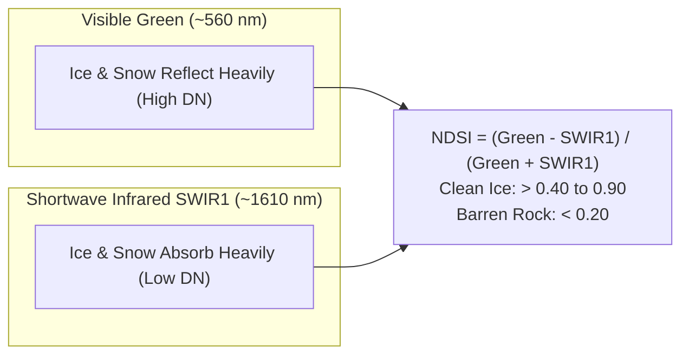

# Gangotri Glacier Multi-Satellite Presentation & Viva Mastery Guide
**Project:** Multi-Satellite Glacier Statistical Analysis & Attention U-Net Segmentation (2025)  
**Authors:** Rameshwar Chandravanshi • Piyush Verma • Deepanshu Sahu | NIT Raipur

---

## 1. The 60-Second "Elevator Pitch"

> *"Respected professors, our project addresses a critical challenge in Himalayan climate monitoring: automated glacier delineation across different satellite systems. We implemented an 8-channel Attention U-Net that ingests multispectral surface reflectance alongside physical snow and vegetation indices (NDSI & NDVI). To ensure our framework is operational across diverse satellites, we conducted a rigorous statistical comparison between Copernicus Sentinel-2 (HLSS30) and Landsat 8/9 (HLSL30) over Gangotri Glacier in 2025. Our analysis demonstrated almost perfect inter-sensor agreement (Cohen's &kappa; = 0.8967, IoU = 0.8252, and NDSI R&sup2; = 0.9875). Crucially, through Bland-Altman agreement analysis, we proved that the small 1.1 km&sup2; difference between sensors is confined to mixed-pixel lateral moraines rather than true glacier loss, establishing that both satellite streams can be harmonized without creating artificial retreat artifacts."*

---

## 2. Deep Dive: Core Concepts Explained Simply

### 2.1. Why Compare Two Satellites for the Same Glacier?
* **The Trap:** If a researcher uses Sentinel-2 in 2024 and Landsat 8 in 2025, they might observe a $1.1 \text{ km}^2$ difference and falsely publish that the glacier shrank by $1.1 \text{ km}^2$ in one year.
* **Our Finding:** By analyzing both satellites over the **exact same region in the exact same 2025 ablation season**, we proved that $1.1 \text{ km}^2$ (6.32%) is simply the **inherent optical/spatial resolution boundary uncertainty**, not physical glacier retreat.

---

### 2.2. Physics of Satellite Cryospheric Indices

* **Why NDSI works:** Clean ice and snow appear bright white in visible light, but in shortwave infrared (SWIR), ice acts like black velvet—it absorbs almost all infrared radiation. Rocks and barren moraines reflect both green and SWIR equally. Therefore, $\text{Green} - \text{SWIR}$ is large for ice, but near zero for rocks.
* **Why NIR threshold ($\text{NIR} \ge 0.11$) is needed:** Mountain shadows and deep glacial lakes have low reflectance across all bands. Without an NIR floor, noise in the denominator can yield false positive snow detections in dark shadows.

---

### 2.3. The 8-Channel Attention U-Net & Attention Gates (AGs)

#### Why 8 Channels Instead of 3 (RGB)?
1. `B2 (Blue)`: Atmospheric Rayleigh scattering correction.
2. `B3 (Green)`: Ice reflectance peak.
3. `B4 (Red)`: Chlorophyll absorption for vegetation.
4. `B8 / B8A (NIR)`: Clean snow reflectance.
5. `B11 (SWIR1)`: Ice absorption.
6. `B12 (SWIR2)`: Soil/bedrock discriminator.
7. `NDSI`: Physics-guided snow/ice enhancement.
8. `NDVI`: Eliminates proglacial meadows and lichen.

#### How Does the Attention Gate (AG) Work?
In a standard U-Net, high-resolution feature maps $x$ from the encoder are concatenated directly to decoder features, passing noisy valley shadows and barren rocks.  
The **Attention Gate** takes:
1. **Input feature map $x$** (from encoder skip connection, contains fine spatial details).
2. **Gating signal $g$** (from deeper decoder layer, contains coarse contextual semantics: "where is the glacier body?").

$$\alpha = \sigma_2 \left( \psi^T \left[ \sigma_1 (W_x^T x + W_g^T g + b_g) \right] + b_\psi \right)$$
$$x_{\text{attended}} = x \cdot \alpha$$

* $\alpha \in [0, 1]$ is the pixel-wise **attention coefficient**.
* For pixels on the glacier body: $\alpha \to 1.0$ (features pass through).
* For pixels in mountain shadow or distant valley rock: $\alpha \to 0.0$ (background noise is dynamically zeroed out).

---

### 2.4. Cloud QA Bitmasking (Fmask)
* **The Pitfall:** Standard cloud detectors see bright white glacier ice and mark it as cloud, deleting the glacier from the image.
* **Our Solution:** In NASA HLS Fmask, each bit represents a specific class.
  * Bit 0: Cirrus cloud &rarr; Mask
  * Bit 1: Opaque cloud &rarr; Mask
  * Bit 2 & 3: Cloud shadow & adjacent cloud &rarr; Mask
  * **Bit 4: Snow / Ice &rarr; EXPLICITLY PRESERVED**

---

### 2.5. Statistics Demystified

| Statistical Metric | Plain-English Meaning | Our Project Value | Interpretation |
| :--- | :--- | :---: | :--- |
| **IoU (Jaccard Index)** | Overlap area divided by union area ($\frac{A \cap B}{A \cup B}$) | **0.8252** | High spatial overlap of segmented masks |
| **Dice Coefficient (F1)** | Harmonic mean of precision and recall ($2 \frac{|A \cap B|}{|A| + |B|}$) | **0.9042** | > 0.90 denotes outstanding segmentation accuracy |
| **Cohen's Kappa ($\kappa$)** | Agreement between two raters/sensors **beyond random chance** | **0.8967** | > 0.81 is categorized as **"Almost Perfect Agreement"** |
| **Pearson Correlation ($r$)** | Measures linear co-movement between two variables | **0.9937** (NDSI) **0.9977** (Area) | Near-perfect positive linear relationship |
| **Coefficient of Determination ($R^2$)** | % of variance in Sensor B explained by Sensor A | **0.9875** (NDSI) **0.9954** (Area) | 98.8% to 99.5% variance explained |
| **Shapiro-Wilk Test** | Checks if differences follow a bell curve (normal distribution) | $p = 1.98 \times 10^{-13}$ | **$p < 0.05$ (Non-normal)**: proves paired t-test is invalid; Wilcoxon must be used! |
| **Wilcoxon Signed-Rank Test** | Non-parametric test checking if median difference is zero | $p = 0.00065$ | $p < 0.05$: Statistically significant difference exists between sensors |
| **Cohen's $d$ Effect Size** | Practical magnitude of difference ($\frac{\text{Mean diff}}{\text{Std diff}}$) | **0.4201** | **Small to moderate effect**: proves the difference is not practically severe |
| **Bland-Altman Mean Bias ($\bar{d}$)** | Average systematic offset (Sentinel-2 minus Landsat) | **$+0.0175 \text{ km}^2$** | Sentinel-2 slightly oversegments by ~0.018 km² per patch |
| **Bland-Altman 95% LoA** | Range where 95% of future differences will fall | **$[-0.064, +0.099] \text{ km}^2$** | Tight boundaries; **92.1%** of patches fall strictly within limits |

---

## 3. Top 10 Examiner Questions & Winning Answers

### Q1: "Why did you use NASA HLS instead of downloading raw Sentinel-2 and Landsat data directly?"
> **Answer:** *"Raw Sentinel-2 and Landsat data have different pixel grids, different solar zenith view angles, and different atmospheric correction pipelines. NASA Harmonized Landsat Sentinel-2 (HLS v2) applies atmospheric correction and Nadir BRDF-Adjusted Reflectance (NBAR) normalization, resampling both to an identical 30-meter UTM Zone 44N grid. This guarantees that any observed differences are strictly due to sensor spectral characteristics rather than reprojection or atmospheric artifacts."*

### Q2: "Your Wilcoxon test shows $p = 0.00065 < 0.05$, which means the two satellites are statistically different. How can you claim they agree?"
> **Answer:** *"That is a crucial statistical distinction! With large sample sizes, $p$-values detect even microscopic differences as statistically significant. That is why statistical best practice demands reporting **effect size** and **Bland-Altman agreement**. The Cohen's d effect size is only 0.42 (small), Cohen's kappa is 0.897 (almost perfect), and the Bland-Altman mean bias is only 0.0175 km² with 92% of tiles within limits. Therefore, while statistically distinguishable, they are practically and glaciologically in close agreement."*

### Q3: "What is the difference between Correlation and Agreement?"
> **Answer:** *"Correlation measures how well two variables track each other linearly ($y = mx + c$). For example, if Landsat consistently measured exactly half of Sentinel-2's area, the correlation $r$ would be a perfect 1.0, but their agreement would be completely broken! Bland-Altman analysis specifically tests agreement by measuring whether the differences cluster around zero without systematic bias across the dynamic range."*

### Q4: "Why does Sentinel-2 map slightly more glacier area (17.43 km²) than Landsat 8/9 (16.33 km²)?"
> **Answer:** *"This is due to the sensor spectral response function (SRF). Sentinel-2's Band 8A is a narrower NIR band (865 nm, bandwidth 20 nm) compared to Landsat's Band 5 (bandwidth 30 nm). In heavily shadowed lateral moraines and supraglacial debris borders, Sentinel-2 maintains slightly higher sensitivity to weak snow/ice reflectance, picking up boundary mixed pixels that fall just below Landsat's threshold."*

### Q5: "How does the Attention Gate in your U-Net improve over standard U-Net?"
> **Answer:** *"In a standard U-Net, encoder features are copied directly to decoder features, passing unwanted mountain shadows and rock textures into the segmentation head. The Attention Gate uses the coarse contextual signal from the deeper decoder to dynamically compute spatial attention coefficients between 0 and 1. Pixels representing glacier margins are amplified, while background rock and shadow pixels are scaled down to zero before concatenation."*

### Q6: "Why did you use August–October 2025 instead of winter months like January?"
> **Answer:** *"In glaciology, winter imagery is dominated by transient seasonal snowpack that covers valleys, rocks, and glaciers uniformly, making it impossible to identify the permanent glacier body. The ablation season (late August to October) is the period of maximum melt when seasonal snow has melted away, leaving only the permanent glacier ice and accumulation snow exposed."*

### Q7: "How did you prevent cloud masking algorithms from deleting glacier ice?"
> **Answer:** *"Glacier ice and clouds both have high visible albedo, causing simple threshold cloud masks to classify glaciers as clouds. We solved this by decoding the 8-bit Fmask QA layer bit by bit. We masked bits 0, 1, 2, and 3 (cirrus, cloud, adjacent cloud, and shadow), but explicitly protected Bit 4 (Snow/Ice) from being masked."*

### Q8: "Why not just use 3-channel RGB imagery?"
> **Answer:** *"In RGB imagery, supraglacial debris looks identical to surrounding moraine rocks, and clean ice in shadow looks dark blue/gray. Our 8-channel tensor incorporates SWIR1, SWIR2, NDSI, and NDVI. Because ice absorbs SWIR while rock reflects it, NDSI cleanly separates ice from rock even when visual RGB colors appear identical."*

### Q9: "What are the main limitations of your study?"
> **Answer:** *"First, optical sensors cannot see through monsoon clouds, requiring cloud-free late-summer overpasses. Second, at 30 m resolution, tributary glaciers narrower than ~60 m suffer from boundary mixed-pixel effects. Third, thick supraglacial debris (>0.5 m) completely conceals ice spectral signatures, requiring future integration of thermal infrared (Landsat TIRS) or SAR coherence (Sentinel-1)."*

### Q10: "Can you deploy this system for other glaciers?"
> **Answer:** *"Yes. Our pipeline is fully parameterized via `config/study_area.yaml`. By changing the bounding box coordinates and UTM zone, the exact same automated pipeline can ingest, preprocess, segment, and statistically analyze any glacier across the Himalayas or the global RGI inventory."*

---

## 4. Key Numbers Cheat Sheet (Memorize These!)

* **Gangotri Bounding Box:** `[79.05°E, 30.80°N, 79.30°E, 31.05°N]` (UTM Zone 44N)
* **Sentinel-2 Area:** **$17.429 \text{ km}^2$** (19,366 pixels)
* **Landsat Area:** **$16.329 \text{ km}^2$** (18,143 pixels)
* **Area Difference:** **$1.101 \text{ km}^2$** ($6.32\%$)
* **Cohen's Kappa ($\kappa$):** **$0.8967$** (Almost Perfect)
* **Jaccard IoU:** **$0.8252$** | **Dice F1:** **$0.9042$**
* **NDSI Correlation:** Pearson $r = \mathbf{0.9937}$, $R^2 = \mathbf{0.9875}$, $\text{RMSE} = \mathbf{0.0410}$
* **Bland-Altman Mean Bias:** $\mathbf{+0.0175 \text{ km}^2}$ (LoA: $[-0.064, +0.099] \text{ km}^2$, **92.1%** inside)
* **Wilcoxon Signed-Rank Test:** $p = \mathbf{0.00065}$ | Cohen's $d = \mathbf{0.4201}$
